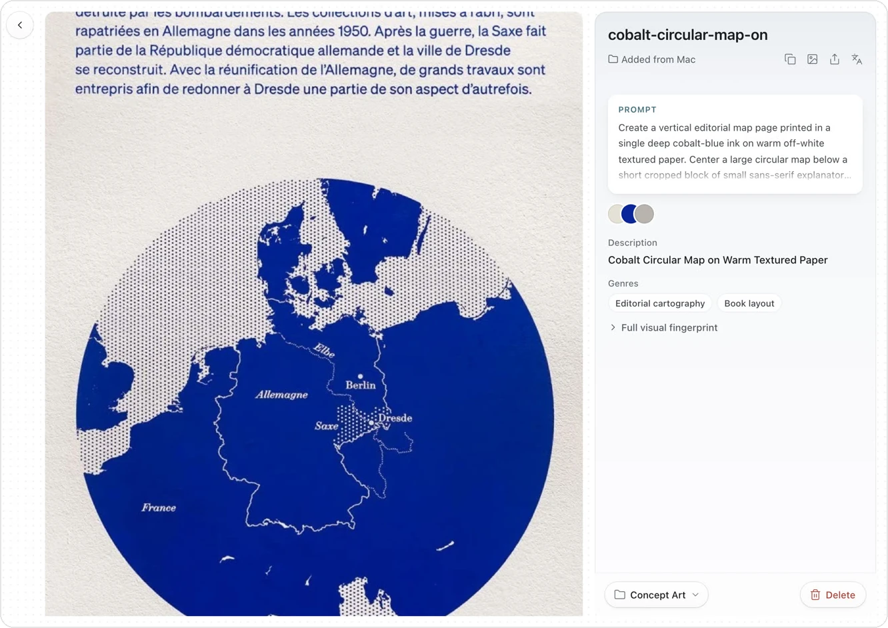

  

<b>English</b> · <a href="README.zh-CN.md">中文</a>

Musepool keeps the images you collect and remembers what makes each one work. This plugin opens your Musepool library inside Obsidian.

  

- **Browse** every image and board without leaving your vault.
- **Reuse** each image's prompt and its Visual Fingerprint: palette, composition, typography and what to avoid.
- **Share** any image as a card that carries its fingerprint.

## Install

**[Download Musepool for Obsidian](https://musepool.art/download/obsidian)**

1. Unzip the download and rename the folder to `musepool`.
2. Move it into your vault's `.obsidian/plugins/` folder.
3. In Obsidian, open **Settings → Community plugins** and turn on **Musepool**.

Musepool runs on macOS. If the Musepool app isn't on your Mac yet, the plugin shows you where to get it.

## License

[MIT](LICENSE). The pictures above come from the author's Musepool library and remain the work of their creators; see [THIRD_PARTY_NOTICES.md](THIRD_PARTY_NOTICES.md). Security reports: [SECURITY.md](SECURITY.md). More at [musepool.art](https://musepool.art).
