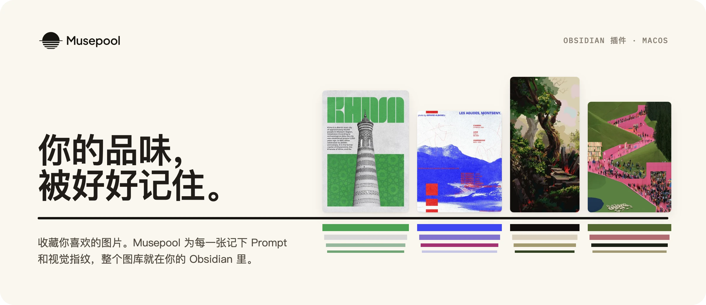
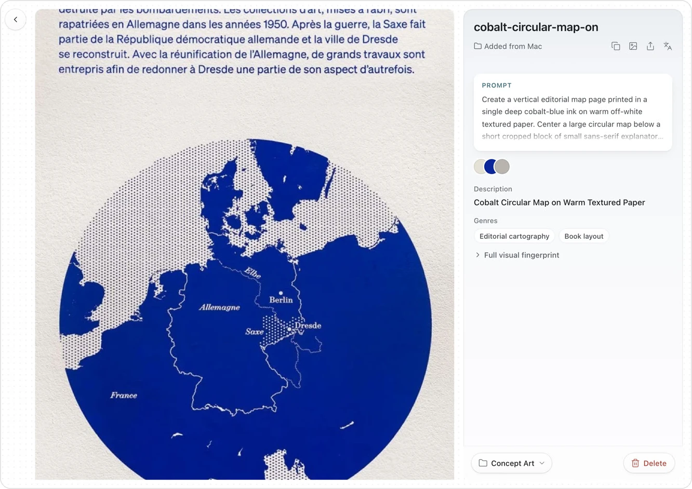

  

<a href="README.md">English</a> · <b>中文</b>

Musepool 帮你留住收藏的图片，并记下每一张好在哪里。这个插件让你在 Obsidian 里直接打开自己的 Musepool 图库。

  

- **浏览**：不离开 Obsidian，就能看所有图片和画板。
- **复用**：每张图都有 Prompt 和视觉指纹，包括配色、构图、字体和要避免的东西。
- **分享**：任意一张图都能做成带视觉指纹的分享卡片。

## 安装

**[下载 Musepool Obsidian 插件](https://musepool.art/download/obsidian)**

1. 解压下载的文件，把文件夹改名为 `musepool`。
2. 把它放进你的 Obsidian 仓库里的 `.obsidian/plugins/` 文件夹。
3. 在 Obsidian 里打开 **设置 → 第三方插件**，开启 **Musepool**。

Musepool 目前只支持 macOS。如果你的 Mac 上还没有 Musepool App，插件会告诉你去哪里下载。

## 许可

[MIT](LICENSE)。上面展示的图片来自作者的 Musepool 图库，版权归原作者所有，详见 [THIRD_PARTY_NOTICES.md](THIRD_PARTY_NOTICES.md)。安全问题见 [SECURITY.md](SECURITY.md)。更多信息：[musepool.art](https://musepool.art)。
